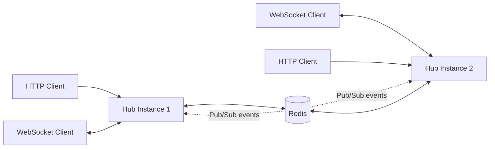

# Distributed Event Hub

A lightweight distributed event-broadcasting service written in Go. It uses **WebSockets** for connected clients and **Redis Pub/Sub** to propagate events between multiple application instances. Redis is also used for request rate limiting and caching metric responses.

## Features

- **WebSocket clients** — connect to `/ws` to receive broadcast messages.
- **Cross-instance broadcasting** — publish an event through one instance; Redis Pub/Sub distributes it to subscribed instances.
- **HTTP broadcast API** — publish raw request-body data as an event.
- **Redis-backed rate limiting** — limits requests by client IP using a Redis Lua script.
- **Metric response caching** — caches metric responses in Redis with a time-to-live.
- **Docker Compose setup** — runs Redis and two application instances locally.

## Architecture



Each application instance has its own in-memory WebSocket hub. Redis Pub/Sub carries published events between instances, allowing clients connected to different instances to receive broadcasts. Redis also stores rate-limit counters and cached metric payloads.

## Tech Stack

- Go
- `net/http` for HTTP routing and handlers
- `github.com/gorilla/websocket` for WebSocket connections
- `github.com/redis/go-redis/v9` for Redis integration
- Redis 7
- Docker and Docker Compose

## Prerequisites

For the Docker Compose setup:

- Docker Engine
- Docker Compose plugin

For running the Go service directly:

- A Go version compatible with the version declared in `go.mod`
- A reachable Redis server

> The current `go.mod` declares `go 1.27.0`. Install a compatible Go toolchain before running the service locally or building the Docker image.

## Getting Started

### 1. Clone the repository

```bash
git clone <repository-url>
cd distributed-event-hub
```

Replace `<repository-url>` with the repository's actual Git URL.

### 2. Start the services

```bash
docker compose up --build
```

This starts Redis and two hub instances:

| Service | Host address | Container port |
|---|---|---|
| `app_1` | `http://localhost:8081` | `8080` |
| `app_2` | `http://localhost:8082` | `8080` |
| `redis` | `localhost:6379` | `6379` |

The application containers wait for Redis's health check before starting.

To stop the services:

```bash
docker compose down
```

To stop them and remove the Compose-managed volumes, if any have been added:

```bash
docker compose down --volumes
```

### 3. Run locally without Docker (optional)

Start Redis separately, then run the application from the repository root:

```bash
export PORT=8080
export REDIS_ADDR=localhost:6379
go run ./cmd/hub
```

The service reads these environment variables:

| Variable | Purpose | Default |
|---|---|---|
| `PORT` | HTTP listening port | No default is assigned in the application |
| `REDIS_ADDR` | Redis host and port | `redis:6379` |

When running outside Docker, set `REDIS_ADDR` to the address of your local Redis server. Set `PORT` explicitly.

## API Reference

### `GET /ws`

Upgrades the HTTP connection to a WebSocket connection. Connected clients receive broadcast messages.

Example using `websocat`:

```bash
websocat ws://localhost:8081/ws
```

Connect a second terminal to `ws://localhost:8082/ws` to test delivery across instances.

### `POST /api/v1/broadcast`

Publishes the raw request body to the Redis channel `events:broadcast`. The service responds with HTTP `202 Accepted` when Redis accepts the publish operation.

```bash
curl -i \
  -X POST http://localhost:8081/api/v1/broadcast \
  -H 'Content-Type: text/plain' \
  --data 'Hello from the distributed event hub'
```

Expected response body:

```json
{"status":"published"}
```

Keep a WebSocket client connected to each instance while sending the request. The connected clients should receive the event through Redis Pub/Sub.

**Payload format:** the handler publishes the request body as-is; it does not validate that the body is JSON.

### `GET /api/v1/metrics/{id}`

Returns a metric payload for the supplied ID. Responses are cached in Redis under `metrics:{id}`. A cache hit sets `X-Cache: HIT`; a cache miss sets `X-Cache: MISS`. The cache TTL is 60 seconds plus a random jitter of up to 9 seconds.

Example:

```bash
curl -i http://localhost:8081/api/v1/metrics/demo
```

The current `fetchFromDB` function is a **placeholder**, not a real database integration. It simulates a 50 ms delay and returns the requested ID and timestamp. The CPU and memory fields are currently left at their zero values.

## Rate Limiting

The HTTP mux is wrapped in Redis-backed rate-limiting middleware configured for **10 requests per IP per one-second window**. Requests over the limit receive HTTP `429 Too Many Requests`, a `Retry-After: 1` header, and this response:

```json
{"error":"Too Many Requests"}
```

The limiter uses a Redis counter with an expiry, updated atomically using a Lua script.

> **Deployment note:** the middleware trusts `X-Forwarded-For` when present. Only trust this header when it is set or sanitized by a trusted reverse proxy; otherwise clients may be able to spoof their rate-limit identity.

## Project Structure

```text
.
├── cmd/
│   └── hub/
│       └── main.go             # Application entry point and HTTP routes
├── internal/
│   ├── cache/
│   │   └── metrics.go          # Redis-backed metric cache and HTTP handler
│   ├── limiter/
│   │   └── limiter.go          # Redis Lua-script rate limiter and middleware
│   ├── pubsub/
│   │   └── listener.go         # Redis Pub/Sub subscription and publishing
│   └── socket/
│       ├── client.go           # WebSocket connection read/write pumps
│       └── hub.go              # Client registration and message fan-out
├── Dockerfile
├── docker-compose.yml
├── go.mod
└── go.sum
```

## Development

Format the Go code:

```bash
gofmt -w ./cmd ./internal
```

Run the test suite:

```bash
go test ./...
```

Build the service:

```bash
go build -o hub ./cmd/hub
```

No test files are currently included in the repository.

## Current Limitations and Production Considerations

- **Redis availability:** startup logs the result of `PING`, but the application does not currently fail fast or retry startup when Redis is unavailable.
- **HTTP server lifecycle:** `http.ListenAndServe` errors are not handled, and there are no configured server timeouts or graceful-shutdown hooks.
- **Rate-limit errors:** Redis errors from the limiter are treated like denied requests, so Redis failures can appear as HTTP 429 responses.
- **WebSocket origin policy:** the upgrader allows requests with no `Origin` header and allows only the configured localhost origins otherwise. Configure this carefully for the intended deployment.
- **Metrics implementation:** metric retrieval is simulated; no external database is queried yet.
- **Cache error handling:** Redis cache write errors and JSON-marshalling errors are not surfaced by the current handler.
- **Pub/Sub delivery:** Redis Pub/Sub is transient and does not persist events for disconnected consumers. This is broadcast messaging, not a durable queue.
- **Container configuration:** the Dockerfile targets `linux/amd64`; adjust the build configuration if other architectures are required.
- **Configuration and security:** Redis currently uses no password in the application configuration. Use appropriate network isolation and authentication for a production deployment.

## License

Open-source under the MIT License.
