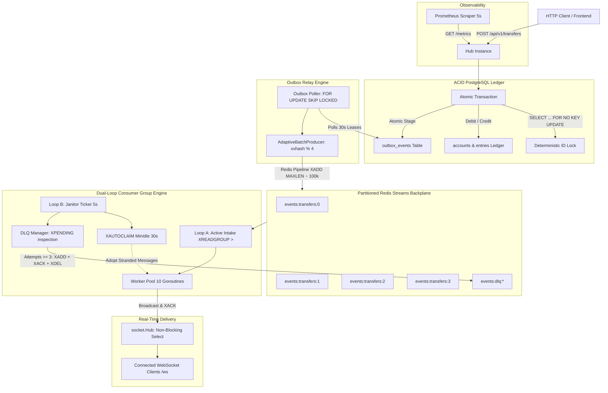

# Distributed Event Hub

An enterprise-grade, event-driven financial ledger and streaming hub written in Go. It combines an **ACID double-entry ledger** in PostgreSQL with the **Transactional Outbox Pattern**, deterministic stream partitioning via **Redis Streams**, fault-tolerant **Dual-Loop Consumer Groups** (active intake + crash-recovery auto-claim janitor), poison-pill **Dead-Letter Queue (DLQ) isolation**, and real-time **WebSocket broadcasting** instrumented with **Prometheus**.

---

## Architecture Overview



---

## Core Capabilities & Guarantees

### 1. Zero Dual-Write Inconsistencies (Transactional Outbox)
* Double-entry ledger updates (`accounts`, `entries`, `transfers`) and event staging (`outbox_events`) execute inside the exact same atomic database transaction.
* If a balance check or overdraft fails, the outbox event rolls back cleanly with zero data drift.
* Background `OutboxPoller` claims unhandled events using `SELECT ... FOR UPDATE SKIP LOCKED` with a 30-second lease timestamp (`locked_until`), enabling safe multi-instance concurrency without duplicate processing or row-lock contention.

### 2. Deterministic Partitioning & Adaptive Micro-Batching
* Events are partitioned across 4 parallel Redis Stream partitions (`events:transfers:0..3`) using 64-bit hashing: `xxhash(aggregateID) % 4`, ensuring strict per-account event ordering.
* `AdaptiveBatchProducer` buffers publish operations in memory and dispatches them via Redis Pipelines on dual triggers: **500 items** or **5ms elapsed window**, achieving high throughput while guaranteeing low latency.
* Streams use approximate memory capping (`MAXLEN ~ 100000`) for bounded $O(1)$ RAM eviction.

### 3. Dual-Loop Consumer Groups & Crash Resilience
* **Loop A (Active Intake):** Continuously calls `XREADGROUP ... >` with a 2s block, dispatching received messages to a 10-worker pool for WebSocket broadcasting and sending an explicit `XACK` upon completion.
* **Loop B (Orphan Adoption Janitor):** Patrols every 5s using `XAUTOCLAIM` with `MinIdle = 30s`. If a container dies (`SIGKILL`), unacknowledged messages in its Pending Entries List (PEL) are automatically adopted by surviving alive nodes with zero message loss.

### 4. Dead-Letter Queue (DLQ) & Poison-Pill Isolation
* Inspects the Pending Entries List using `XPENDING - + 50`.
* If an event's delivery attempts reach the poison-pill threshold (`retry_count >= 3`), it executes an atomic pipeline:
  1. `XADD` to `events:dlq:{stream}` with rich diagnostics (original ID, payload, failure reason, timestamp).
  2. `XACK` on the active consumer group to clear it from the PEL.
  3. `XDEL` on the source stream to prevent memory leaks and unhandled consumer panics.

### 5. Slow-Consumer Isolation
* WebSocket outbound queues (`client.send`) are buffered at 256 items.
* Message fan-out uses non-blocking Go channel selects. If a slow or paused client saturates its buffer, the hub immediately closes the slow socket and evicts it without blocking healthy peer connections or inflating server memory.

### 6. Prometheus Observability Suite
Exposes real-time streaming telemetry on `GET /metrics`:
* `eventhub_streaming_consumer_lag` (Gauge): Total unread stream entries plus unacknowledged in-flight PEL entries per partition and group.
* `eventhub_streaming_dispatch_latency_seconds` (Histogram): End-to-end latency from PostgreSQL `outbox_events.created_at` to consumer worker `XACK`.
* `eventhub_streaming_pipeline_batch_size` (Histogram): Distribution of micro-batch sizes flushed to Redis Pipelines.
* `eventhub_streaming_dlq_messages_total` (Counter): Cumulative count and rate of poison pills isolated into Dead-Letter Queues.

### 7. Coordinated Graceful Teardown
Binds OS interrupt signals (`SIGINT`, `SIGTERM`) to trigger an ordered 4-step shutdown:
1. **Step A:** Stop accepting new HTTP requests (`server.Shutdown`).
2. **Step B:** Flush all active producer micro-batch pipelines to Redis and stop telemetry exporters (`streamPublisher.Close()`, `lagExporter.Stop()`).
3. **Step C:** Allow background pollers and worker pools to drain in-flight messages and send pending `XACK`s.
4. **Step D:** Safely close Redis (`rdb.Close()`) and PostgreSQL connection pools (`pool.Close()`).

---

## Tech Stack

* **Language:** Go
* **Database:** PostgreSQL 16 (ACID Double-Entry Ledger & Transactional Outbox)
* **Driver / Connection Pool:** `github.com/jackc/pgx/v5` (`pgxpool`)
* **Streaming & Cache:** Redis 7 (Partitioned Streams, Consumer Groups, PEL, Lua Rate Limiter)
* **Redis Client:** `github.com/redis/go-redis/v9`
* **Partition Hashing:** `github.com/cespare/xxhash/v2`
* **Real-Time Transport:** WebSockets (`github.com/gorilla/websocket`)
* **Metrics:** Prometheus (`github.com/prometheus/client_golang`)

---

## Getting Started

### 1. Start the Distributed Cluster with Docker Compose

```bash
docker compose up -d
```

This starts:
* `postgres`: PostgreSQL 16 ledger on host port `5432` with auto-initialized schemas in `db/migrations/`.
* `redis`: Redis 7 alpine on host port `6379`.
* `app_1`: Hub Node 1 on host port `8081` (internal `8080`).
* `app_2`: Hub Node 2 on host port `8082` (internal `8080`).
* `prometheus`: Prometheus server on host port `9090` scraping both app nodes every 5 seconds.

### 2. Verify Container Health

```bash
docker compose ps
```

---

## API Reference

### 1. Financial Transfer (ACID Ledger & Outbox Staging)
`POST /api/v1/transfers`

Executes an atomic transfer between two accounts with deterministic deadlock-free locking (`SELECT ... FOR NO KEY UPDATE` in sorted order), updates the ledger, and stages an outbox event.

```bash
curl -i -X POST http://localhost:8081/api/v1/transfers \
  -H "Content-Type: application/json" \
  -d '{
    "from_account_id": "0f4b58af-5cb7-431e-a055-be3f48e1ec37",
    "to_account_id": "4383b7de-256a-4d22-996b-8c7cc67e77bf",
    "amount": 250,
    "currency": "USD"
  }'
```

**Response (HTTP 201 Created):**
```json
{
  "transfer": {
    "id": "f7763cd4-31a7-43cf-b814-c8f89ae8ba1b",
    "from_account_id": "0f4b58af-5cb7-431e-a055-be3f48e1ec37",
    "to_account_id": "4383b7de-256a-4d22-996b-8c7cc67e77bf",
    "amount": 250,
    "created_at": "2026-10-19T07:36:59.227Z"
  },
  "from_account": { "id": "0f4b58af...", "balance": 4750 },
  "to_account": { "id": "4383b7de...", "balance": 1250 },
  "outbox_event": {
    "sequence_id": 2001,
    "status": "PENDING"
  }
}
```

### 2. Real-Time WebSocket Notifications
`GET /ws`

Upgrades connection to a WebSocket. Receives real-time JSON event notifications when transfers complete on any node in the cluster.

```bash
# Using websocat or wscat:
websocat ws://localhost:8081/ws
```

### 3. Prometheus Metrics Endpoint
`GET /metrics`

Returns live Prometheus metrics including consumer lag, end-to-end dispatch latency histograms, and DLQ counter stats.

```bash
curl -s http://localhost:8081/metrics
```

### 4. Cached Metrics Query
`GET /api/v1/metrics/{id}`

Returns cached metric responses with TTL + random jitter, tracking cache hits/misses via headers (`X-Cache: HIT` / `X-Cache: MISS`).

---

## Running the Automated Test Suite

### Run Storage Tests (ACID Overdraft Rollback & Dual-Worker Race Verification)
```bash
go test -v ./internal/storage/...
```

### Run Socket Tests (Slow-Consumer Eviction & Non-Blocking Guarantee)
```bash
go test -v ./internal/socket/...
```

---

## Project Structure

```text
.
├── cmd/
│   └── hub/
│       └── main.go                 # Application bootstrap, routing & graceful teardown
├── db/
│   └── migrations/                 # PostgreSQL schema migrations (accounts, transfers, outbox)
├── internal/
│   ├── cache/
│   │   └── metrics.go              # Cached metric endpoints with jitter
│   ├── limiter/
│   │   └── limiter.go              # Redis Lua rate limiter middleware
│   ├── relay/
│   │   ├── poller.go               # Transactional outbox SKIP LOCKED leasing engine
│   │   └── publisher.go            # Stream publisher abstraction
│   ├── socket/
│   │   ├── client.go               # WebSocket connection read/write pumps
│   │   ├── hub.go                  # Non-blocking fan-out hub
│   │   └── hub_test.go             # Slow-consumer isolation tests
│   ├── storage/
│   │   ├── db.go                   # PostgreSQL pgxpool initialization
│   │   ├── outbox.go               # Outbox staging & state transitions
│   │   ├── repository.go           # Repository interfaces
│   │   ├── transfer.go             # Atomic double-entry financial ledger logic
│   │   └── transfer_test.go        # ACID tests & multi-worker race verification
│   ├── streaming/
│   │   ├── consumer.go             # Dual-Loop Consumer Group (Loop A intake + Loop B recovery)
│   │   ├── dlq.go                  # Dead-Letter Queue & poison-pill isolation pipeline
│   │   └── producer.go             # Adaptive micro-batching producer with xxhash & pipeline flush
│   └── telemetry/
│       └── metrics.go              # Prometheus Gauge, Histogram, Counter definitions & LagExporter
├── prometheus/
│   └── prometheus.yml              # Prometheus 5s scrape configuration
├── docker-compose.yml              # Multi-node local cluster specification
├── Dockerfile                      # Production container image definition
├── go.mod
└── go.sum
```

---

## License

Open-source under the MIT License.
